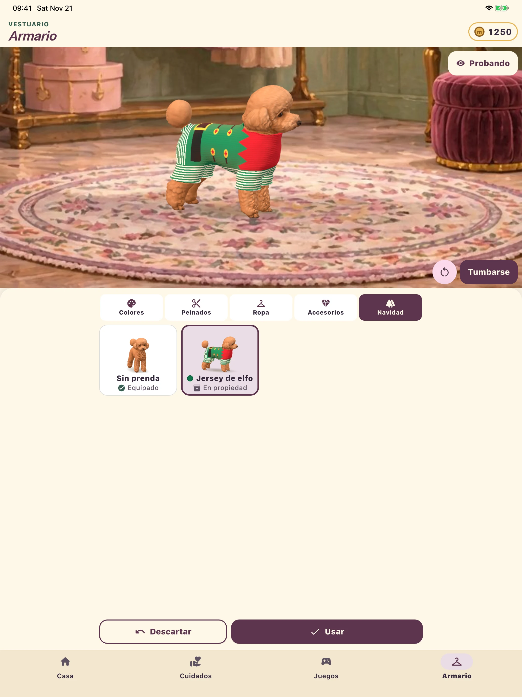

# Navidad · 21-11-2026

Primera prenda: **Jersey de elfo**, inspirada en la foto aportada por el propietario. Se recrea el diseño mediante el material local del jersey 3D: cuello rojo, unión en zigzag, cuerpo verde, botones de hilo dorados/rojos, cinturón negro, hebilla dorada y bandas de punto blanco/verde. No se usa la foto como textura ni se incluyen marcas o embalaje. La malla y los mapas de tejido existentes conservan su ajuste y animación. La miniatura sale del mismo visor, de perfil a tres cuartos.

En **Armario → Navidad** se puede probar, comprar, equipar y quitar. Precio base: **320 monedas**, versión completa, con el incremento del 20 % compartido únicamente con otros jerséis especiales. Los colores normales no cuentan. La colección está disponible todo el año y el ID se guarda con el formato existente. 11 idiomas y respaldo 2D.

## Capturas nativas

Mismo iPad Pro 13 (M5), iOS 26.5, **2064 × 2752 píxeles**, 1032 × 1376 puntos, DPR 2. Capturas originales del framebuffer con `simctl`, incluyendo el WKWebView/WebGL, convertidas a WebP a la misma resolución. Partida ficticia solo en memoria y tienda simulada; no son una prueba en iPhone físico. Recorrido correcto, visor sin fallos, sin excepciones ni desbordes; equipar conserva el ID. [Metadatos](manifest.json).

| Vista | Captura |
|---|---|
| Frente y categoría | [Frente](01-navidad-frente.webp) |
| Perfil | [Perfil](02-navidad-perfil.webp) |
| Espalda | [Espalda](03-navidad-espalda.webp) |
| Tumbado | [Tumbado](04-navidad-tumbado.webp) |
| Modo foto | [Foto](05-navidad-modo-foto.webp) |



## Ajuste del visor

Diez capturas del WebGL local: natural, pompón y concurso desde tres ángulos, más concurso tumbado con pelaje verde. Sin errores de JavaScript/GLSL. Muestras: [natural](elf-natural-side.webp), [pompón](elf-pom-front.webp), [concurso de espaldas](elf-show-back.webp) y [tumbado](elf-resting.webp).

Reproducir desde la raíz del repo:

```sh
node tool/arte/poc_3d/catalog_thumbnails.mjs outfit.sweater_elf
node tool/arte/poc_3d/catalog_thumbnails.mjs --christmas
TABLET_OUTPUT=../reviews/navidad-ipad-20261121 flutter drive --driver=test_driver/tablet_screenshots.dart --target=integration_test/tablet_screenshots_test.dart --device-id=<iPad-simulator> --dart-define=POODLE_LIVE_3D=true --dart-define=CHRISTMAS_CAPTURE=true --no-pub
```

## Integración de la copia antigua

Recuperados el control de existencia de las tres músicas en `tool/validate_content.dart`, la documentación que seguía marcándolas como pendientes y los tres informes históricos de instalación 29–31 (`docs/pruebas/iphone-{music,rebase,3d}-2026-11-19.json`), eliminando una ruta personal obsoleta. La confirmación visual 3D corresponde a la build 31; no se declara probada la escucha física.

Las tres pistas, cuatro imágenes de revisión, vestuario articulado y su prueba ya coincidían con main. El resto de cambios de música, navegación, ajustes, cuidados y vestuario corresponde a versiones anteriores ampliadas o corregidas en main; se conserva la versión vigente. No se trasplantan archivos antiguos completos. Los registros de esas sesiones ya están en `docs/ESTADO.md`.
